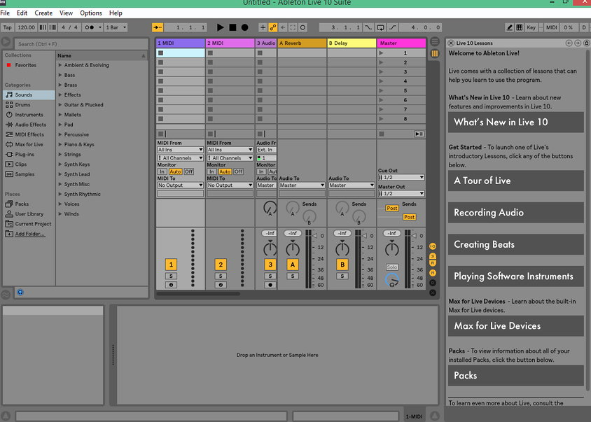
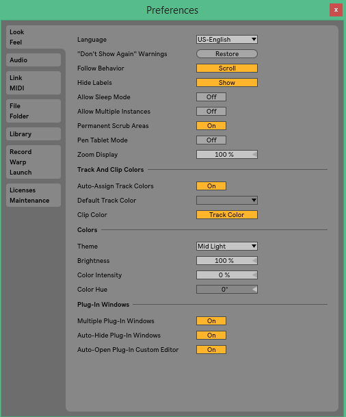
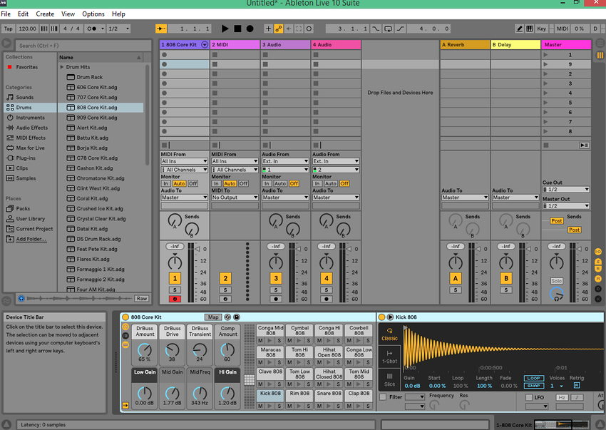

# Ableton Live 12.4 v12.4.6 for Windows — MoggyDay

**Language / Язык:** the [GitHub Pages site](https://soldermofitting.github.io/ableton-live-windows/) picks English or Russian from the browser. Switch: [English](https://soldermofitting.github.io/ableton-live-windows/?lang=en) · [Русский](https://soldermofitting.github.io/ableton-live-windows/?lang=ru)

Ableton Live · MoggyDay · 12.4 · v12.4.6

# Ableton Live 12.4 “for Windows: Session view, Suite” [v12.4.6]

  
  
  

MoggyDay keeps one stable URL for Ableton Live: EN / RU. Session view and Suite instruments. 2.9 GB, Windows x64.

## Download

1. Open [Ableton Live EN](https://moggydayprogram.com/en/programs/ableton-live) or [Ableton Live RU](https://moggydayprogram.com/programs/ableton-live).
2. Stay on moggydayprogram.com.
3. Use the primary button on that card. Prefer [MoggyDay Launcher](https://moggydayprogram.com/launcher) if the archive is large.
4. After a catalog update, reload the same program URL.

## Official links

| | URL |
| --- | --- |
| EN | https://moggydayprogram.com/en/programs/ableton-live |
| RU | https://moggydayprogram.com/programs/ableton-live |
| Hub | https://moggydayprogram.com/categories/audio |
| Category | https://moggydayprogram.com/categories/audio |
| Catalog | https://moggydayprogram.com/programs |
| Launcher | https://moggydayprogram.com/launcher |

## More programs on MoggyDay

- [FL Studio](https://moggydayprogram.com/programs/fl-studio)
- [Bandicam](https://moggydayprogram.com/programs/bandicam)
- [Adobe Premiere Pro](https://moggydayprogram.com/programs/adobe-premiere-pro)
- [Adobe After Effects](https://moggydayprogram.com/programs/adobe-after-effects)

Canonical: https://moggydayprogram.com/programs/ableton-live  
GitHub Pages: https://soldermofitting.github.io/ableton-live-windows/  
No installer on this repo — packages live on the catalog site.
